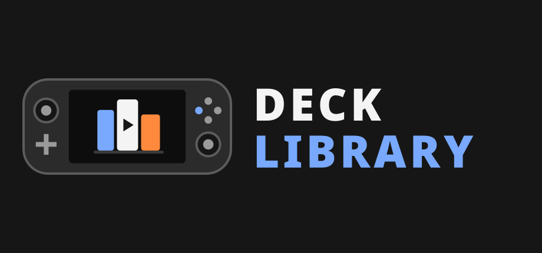
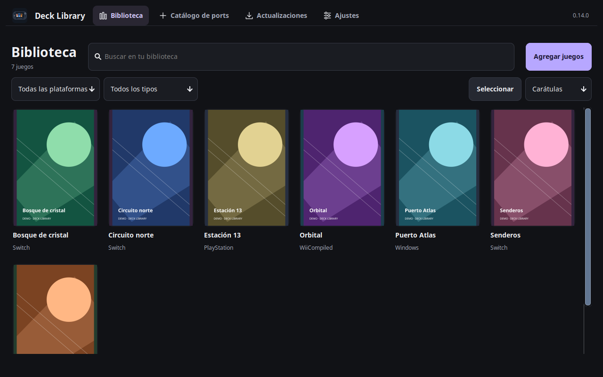
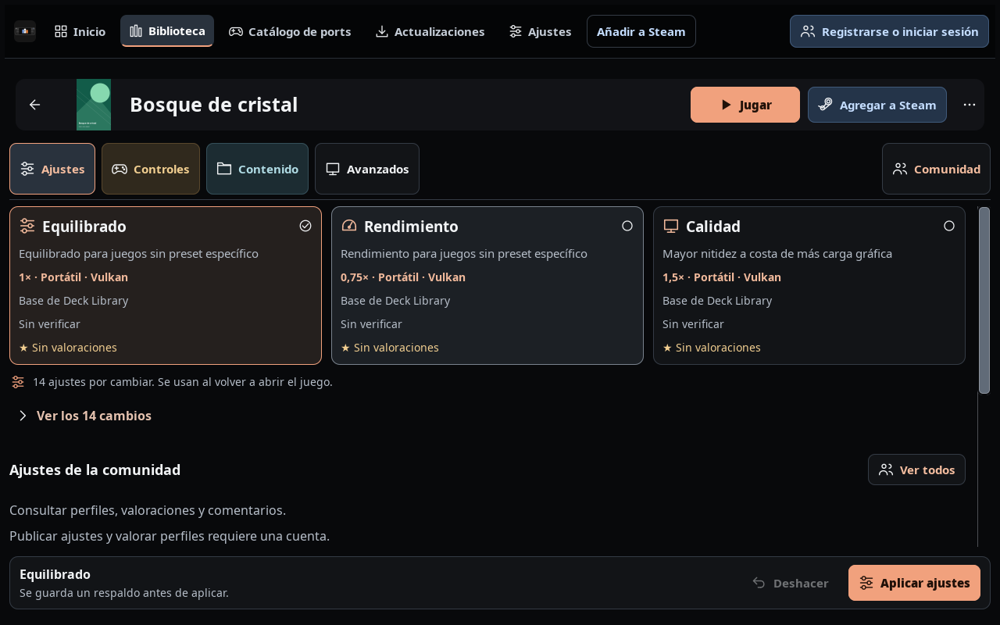

<h1 align="center">Deck Library</h1>

  

Ports, juegos emulados e instancias de Minecraft. Una biblioteca para Steam Deck.

  
  
  

  <a href="https://github.com/GonzaCass/deck-library/releases/latest"><strong>Descargar</strong></a> ·
  <a href="README.md">English</a> ·
  <a href="docs/README.md">Documentación</a> ·
  <a href="https://github.com/GonzaCass/deck-library/issues">Informar un problema</a>

## 🎮 Una biblioteca para los juegos

- **Biblioteca:** detectar juegos de EmuDeck, ports instalados e instancias de Prism Launcher, con carátulas verticales y filtros por plataforma.
- **Ports:** explorar, instalar y actualizar los proyectos compatibles. Consultar los originales necesarios y elegir los archivos que falten al preparar el juego.
- **Ajustes por juego:** comparar perfiles compactos, desplegar sus detalles y aplicar cambios con respaldo.
- **Comunidad:** compartir ajustes, valoraciones y comentarios desde la app.
- **Ayuda:** guía de primer uso, pruebas de juego en Steam Deck y preparación de reportes de errores.
- **Steam:** agregar juegos o Deck Library, con carátulas y navegación con mando en modo Juego.

Ver la pantalla de ajustes de un juego

## 🚀 Instalar

1. Pasar la Deck a **modo Escritorio** y descargar el paquete de [la última versión](https://github.com/GonzaCass/deck-library/releases/latest).
2. Extraerlo, abrir la carpeta y hacer doble clic en **Instalar.sh**. Elegir **Ejecutar**.
3. Completar el asistente y revisar los juegos detectados.

Si el archivo se abre como texto, ejecutar `python3 install.py --desktop` en esa carpeta. Requiere Python 3.11+ y GTK 3/PyGObject. No necesita sudo ni pip en la Steam Deck utilizada para las pruebas.

## 🕹️ Abrir desde Steam

1. En modo Escritorio, abrir Deck Library y pulsar **Añadir a Steam** junto a las pestañas superiores.
2. Si Steam está abierto, los cambios quedan en el aviso de pendientes. Cerrar Steam una vez para guardarlos.
3. Volver al **modo Juego**, buscar **Deck Library** en Steam y pulsar **Jugar**.

Para agregar un juego, abrir su carátula y elegir **Agregar a Steam**. Después se puede ejecutar directamente desde Steam.

**Controles:** palanca izquierda/cruceta para mover · derecha para desplazar · **A** seleccionar · **B** volver · **LB/RB** pestañas · **X** teclado de búsqueda. También admite pantalla táctil y trackpad.

## 🔄 ¿Ya está instalado?

Abrir Deck Library en **modo Escritorio → Actualizaciones → Buscar actualizaciones**. La actualización automática de la app está activada por defecto en modo Escritorio; volver a abrirla después de instalar. También se puede ejecutar el instalador nuevo: conserva la biblioteca, los perfiles y la configuración.

El icono de la app y del escritorio se actualiza con la instalación. El arte oficial antiguo de Steam se renueva automáticamente; las imágenes personalizadas y las elecciones manuales pendientes se conservan. Los cambios de Steam se guardan al cerrar Steam, con respaldo.

Originales, compatibilidad y cuentas

Un port puede necesitar una ROM, revisión de disco, BIOS o carpeta extraída específica. La app detecta los originales compatibles o permite elegir su ubicación. No incluye archivos de juegos.

El porcentaje de compatibilidad es un índice basado en metadatos; no mide el rendimiento del juego. **Catálogo de ports → Guía de compatibilidad** explica los colores y el cálculo.

Hace falta una cuenta para publicar o valorar ajustes comunitarios. La biblioteca y los perfiles locales se pueden usar sin iniciar sesión. Algunos proyectos necesitan preparación manual; [requisitos y rutas admitidas](docs/PORTS.md) detalla esos casos.

## 📖 Más información

[Documentación](docs/README.md) · [Imágenes para compartir](https://github.com/GonzaCass/deck-library/tree/main/promo) · [Ports y requisitos](docs/PORTS.md) · [Perfiles](docs/PRESETS.md) · [Novedades](docs/CHANGELOG.md) · [Validación](docs/VALIDATION.md)

**Ayuda → Reportar un problema** permite revisar un diagnóstico y exportar un ZIP para adjuntar a un [issue de GitHub](https://github.com/GonzaCass/deck-library/issues). El envío al proyecto es opcional. Revisar su contenido antes de compartirlo.

[Licencia MIT](LICENSE). Proyecto independiente, sin afiliación con Valve ni con los emuladores o ports integrados.
