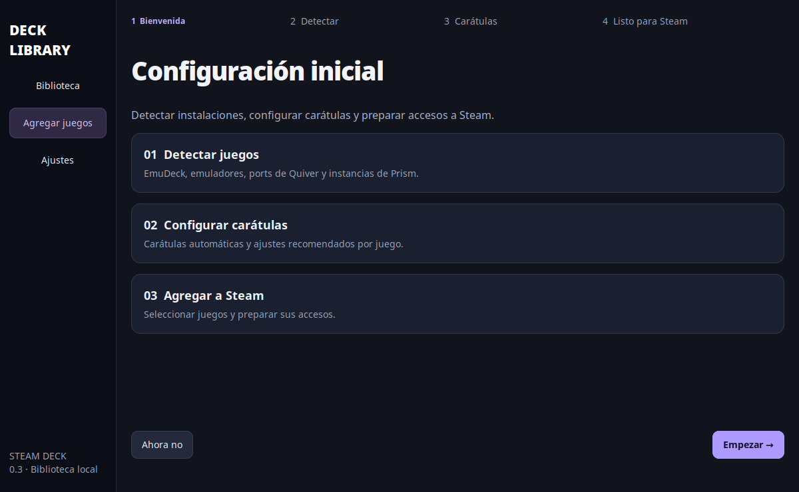

# Deck Library — guía para Steam Deck

Agregá ports, aplicaciones y juegos emulados a Steam desde una sola ventana.

**GTA IV:** buscá lo instalado, abrí la ficha del juego y elegí **Ver arreglo → Aplicar arreglo de GTA IV**. Instala FusionFix 4.0.5 y los ajustes de DXVK confirmados en esta Deck, con respaldo y restauración. No abre el juego. [Instructivo y detalles](docs/GTAIV.md).

## Instalación para vos o un amigo

1. Copiá y extraé `DeckLibrary-0.3.3.tar.gz` en modo Escritorio.
2. Abrí la carpeta y hacé doble clic en **Instalar.sh**. Elegí **Ejecutar** cuando Dolphin pregunte.
3. Se instala la aplicación y se abre. También queda **Deck Library** en el escritorio y en el menú de aplicaciones.

Si Dolphin abre el archivo como texto, abrí una terminal en esa carpeta y ejecutá `python3 install.py --desktop`. Necesita Python 3.11+ y GTK 3/PyGObject; se verificaron en la Deck utilizada. No necesita sudo ni pip.

## Primer inicio

Se abre un asistente de cuatro pasos: **Bienvenida → Detectar → Carátulas → Listo para Steam**. Busca EmuDeck, emuladores, ports e instancias de Prism en segundo plano. Revisá los juegos encontrados y agregá una carpeta si falta algo. Elegí el proveedor de carátulas y abrí tu biblioteca. Podés repetirlo desde **Ajustes**.

## Tu biblioteca

Las carátulas tienen formato vertical 2:3. Tocá una para abrir su ficha: **Jugar** y **Agregar a Steam** son las acciones principales. Debajo están los presets, el contenido de Switch y los controles de Minecraft cuando corresponden. Rutas, comandos y el interruptor de mods quedan en **Opciones avanzadas**.

Para agregar varios juegos, tocá **Seleccionar**, marcá las carátulas y usá **Agregar a Steam** en la barra inferior. Si Steam está abierto, elegí **Reiniciar Steam y guardar** después de cerrar el juego que estés usando. Los accesos aparecen en **No Steam** en modo Juego.

**Agregar juegos** ofrece tres caminos: buscar lo instalado, elegir una ROM/app o preparar Mario Kart Wii. En **Ajustes → Instalaciones y carpetas** podés corregir las rutas de emuladores, ports, Prism y bibliotecas en microSD. Los ejecutables Windows necesitan un launcher de Wine/Proton configurado.

## Carátulas automáticas

**Automático** usa SteamGridDB si agregaste una clave personal; si no, busca carátulas en Libretro para las consolas compatibles y una imagen del juego en Wikipedia. Funciona sin crear una cuenta. Cuando una coincidencia es dudosa, se conserva una tarjeta de título para que elijas la imagen. Wikipedia puede devolver arte representativo de un artículo compartido por varias ediciones, en vez de la caja exacta.

Para carátulas verticales de la comunidad, elegí **SteamGridDB** en el asistente o en **Ajustes** y agregá tu [clave API personal](https://www.steamgriddb.com/profile/preferences/api). Esta integración requiere una clave válida; no se incluye una clave compartida en el paquete.

En la ficha, **Cambiar carátula** permite buscar por nombre, elegir entre los resultados o usar **Elegir imagen local**. El origen de cada descarga queda visible. Las imágenes y la clave se guardan solamente en esta Deck y no se incluyen al exportar presets o feedback. Las consultas envían el nombre del juego al proveedor. Sin conexión, los juegos y las carátulas ya guardadas siguen disponibles.

Hay transiciones entre pantallas y pasos del asistente, respuesta visual al pasar por las carátulas e indicadores durante las búsquedas. Podés desactivar las animaciones en **Ajustes**.

## Mods y partidas

En Switch, **Opciones avanzadas** permite activar **Usar mods instalados en Eden**. Desactivarlo prepara un perfil sin mods que conserva la ubicación de partidas, NAND y controles. No borra mods ni cambia la configuración principal. Los nuevos juegos de Switch usan los mods instalados por defecto; podés desactivarlos para comparar el arranque. Las actualizaciones y los DLC instalados siguen disponibles.

## Qué se comparte

El paquete incluye solamente la app, su código MIT, documentación y pruebas. **Cada persona aporta sus juegos y sus emuladores ya instalados.** No incluye tus ROMs, claves, firmware, cuentas, partidas ni mods. El asistente opcional puede preparar WiiCompiled usando una imagen propia y el setup oficial; también reconoce una instalación existente.

Steam se modifica cuando está cerrado, conservando los demás accesos. Se crea un backup junto a `shortcuts.vdf`. La app guarda su biblioteca y registros en `~/.local/share/deck-library`; no publiques esa carpeta.

## Estado de esta versión

Versión **0.3.3**. Los resultados de las pruebas están en [docs/VALIDATION.md](docs/VALIDATION.md). El funcionamiento de cada juego depende de su emulador y configuración. El instalador puede volver a ejecutarse para actualizar la app sin borrar tu biblioteca.

Código y versiones descargables: [GonzaCass/deck-library](https://github.com/GonzaCass/deck-library). Para información técnica, consultá [README.md](README.md).

## Funciones de biblioteca y presets

- **Carátulas** como vista inicial; podés cambiar a lista y elegir una imagen local. Se aprovechan imágenes existentes de Steam/Quiver/Prism cuando se encuentran; donde falta arte se muestra una tarjeta de título.
- **Ajustes → Instalaciones y carpetas** detecta EmuDeck y permite agregar carpetas de ROMs/ports, instalaciones de Quiver, Prism y WiiCompiled, y elegir programas de emuladores que no se detectaron.
- Las **instancias de Prism Launcher** aparecen individualmente para agregarlas a Steam. La ficha ofrece un layout recomendado de teclado/ratón y abre los controles de Steam; la selección del layout se hace allí.
- **Preparar Mario Kart Wii** pide tu imagen PAL limpia RMCP01, usa el setup oficial 0.2.33, instala el SDK si falta, recompila y aplica la base nítida confirmada. Puede tardar varios minutos y necesita Internet y unos 20 GB temporales. Trabaja en una instalación propia, sin sobrescribir otra que ya funcione. Podés cancelar y retomar una instalación incompleta.
- En Switch, **Base, updates y mods** muestra contenido, versión detectada por Eden y qué NSP está registrado en NAND. Permite elegir una base faltante, instalar updates/DLC propios y mods ZIP LayeredFS. Que un archivo esté disponible en una carpeta no significa que esté instalado en NAND. La versión base puede necesitar consultarse en Eden si no se identifica.
- **Ajustes recomendados** permite aplicar, respaldar, restaurar, importar/exportar JSON y guardar feedback para compartir. Hay siete perfiles iniciales con su estado de prueba. Algunos son propuestas; no todos están validados jugando.

Para que tu amigo pruebe presets: compartí este paquete, que abra el juego, elija **Ajustes recomendados**, aplique el perfil y use **Exportar comentarios**. Te puede mandar el JSON de feedback y, si cambió algo, exportar sus ajustes. También pueden apuntar al mismo catálogo JSON de GitHub. Todavía no hay cuentas, sitio, base de datos ni subida automática de aportes.

El formato y sus límites están explicados en [docs/PRESETS.md](docs/PRESETS.md).

## Accesos existentes, carátulas y controles de Steam

**Actualizar** vuelve a buscar los ports instalados por Quiver, incluidas sus carpetas personalizadas, y los accesos **No Steam** de la cuenta activa. Si una instancia de Prism ya tiene un acceso, se vincula con él. La detección no incluye toda la biblioteca de juegos comprados en Steam.

En la ficha de un acceso existente, **Editar acceso de Steam** permite cambiar nombre, ejecutable, carpeta de inicio y opciones de lanzamiento. Se conserva su identificador, que mantiene asociados los controles, Proton y el arte. Para guardar estos cambios, Steam debe estar cerrado; la app ofrece guardar más tarde o reiniciarlo desde Escritorio.

La carátula elegida en Deck Library se copia al grid vertical de Steam al agregar o actualizar ese acceso, con copia de seguridad de la anterior. Elegir una nueva imagen no cambia Steam inmediatamente: usá **Agregar a Steam** para guardar también allí. No se generan automáticamente imágenes horizontales, fondos ni logotipos.

**Controles** muestra el perfil de Steam Input guardado localmente para la instancia de Minecraft, cuando está disponible, y abre los controles del acceso correcto. Los perfiles no descargados desde Steam Cloud o configurados en otra cuenta pueden no aparecer. No modifica las asignaciones automáticamente.
