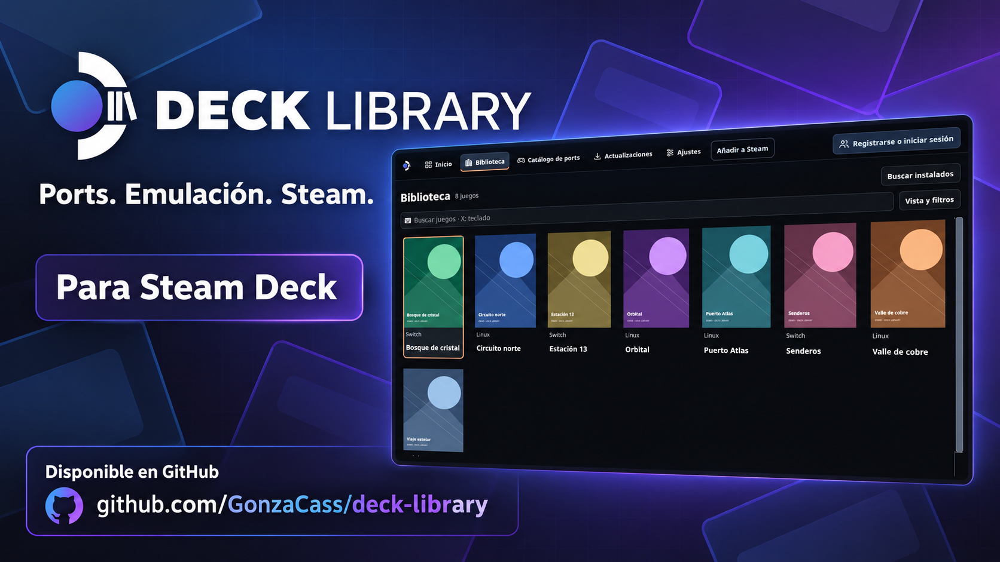

# Deck Library · Promo

[Download ZIP · Descargar pack](https://github.com/GonzaCass/deck-library/releases/download/v1.2.3/DeckLibrary-Promo-2026-10-26.zip)

Three Spanish promotional images using the current brand and public demo screens, generated with the built-in imagegen tool.

| File | Size | Format |
| --- | --- | --- |
| [Horizontal](deck-library-horizontal.png) | 1672 × 941 | Landscape, approximately 16:9 |
| [Square](deck-library-square.png) | 1254 × 1254 | Square post, 1:1 |
| [Story](deck-library-story.png) | 941 × 1672 | Portrait, approximately 9:16 |

The library and profile views use fictional demo games from the project's public screenshots. The original reference screenshots are in [assets](../assets); the generation prompts and reference inputs are recorded in [PROMPTS.md](PROMPTS.md).

## Español

El pack incluye una imagen horizontal, una cuadrada y una vertical para historias. Los tres PNG llevan la identidad actual, textos breves en español y el enlace del repositorio. Las pantallas de referencia usan juegos ficticios de demostración.

Generadas con imagegen integrado. Los tamaños de la tabla corresponden a los archivos entregados. Los textos y las referencias utilizados están en [PROMPTS.md](PROMPTS.md).

Repositorio y descarga de la aplicación: https://github.com/GonzaCass/deck-library
